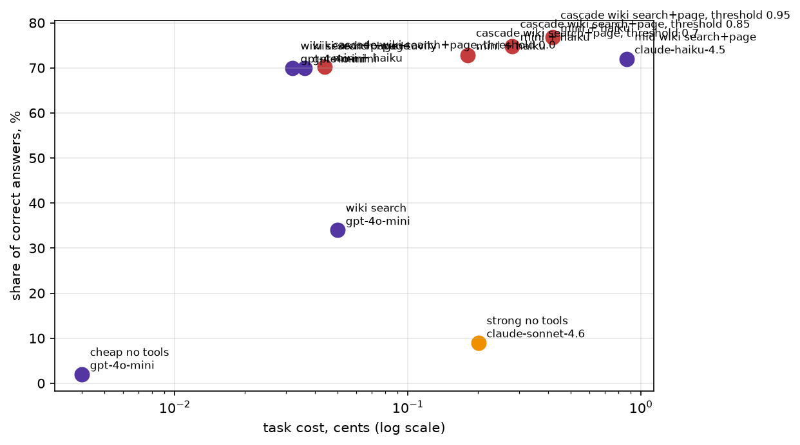

# Домашнее задание 1: свежие вопросы и агент

Код, данные и замер лежат в `hw1/`. Трейсы (запись каждого прогона по шагам) в `hw1/traces`.

## Набор данных

`hw1/data/fresh.jsonl`: 151 вопрос о событиях после 1 января 2025 года (125 стартовых, 26 добавленных, их составили вместе с Claude). В записи есть вопрос, короткий ответ, ссылка и цитата с ответом. Источник: обзорные статьи английской Википедии «2026 in ...».

Проверка свежести (`cd hw1 && python check_fresh.py data/fresh.jsonl --sonnet`, вывод в `hw1/check_fresh_output.txt`): Sonnet 4.6 без инструментов верно отвечает на 6 из 151 (4%) при пределе 20%. Пройдена.

## Агент

Цикл с семинара. Инструменты (`hw1/tools`): поиск по Википедии, чтение страницы `wiki_page_find` (возвращает строки статьи с ключевыми словами), Tavily (второй источник поиска), калькулятор, `python_exec`. У каждого есть тесты на три случая: нормальный вход, пустой результат, ошибка.

В `is_correct` добавлено сравнение дат по дню и месяцу (`15 March` и `2026-03-15`) и чисел словами и цифрами (`two` и `2`).

## Результаты (151 вопрос)

| Конфигурация | Модель | Верных | Цена задачи, USD | Цена верного, USD | Шагов | Время, с |
|---|---|---|---|---|---|---|
| Сильная, без инструментов | claude-sonnet-4.6 | 9,0% | 0,00201 | 0,02170 | 1,0 | 5,6 |
| Дешёвая, без инструментов | gpt-4o-mini | 2,0% | 0,00004 | 0,00205 | 1,0 | 1,7 |
| Дешёвая, только поиск | gpt-4o-mini | 34,0% | 0,00050 | 0,00149 | 4,4 | 9,7 |
| Дешёвая, поиск и чтение страницы | gpt-4o-mini | 70,0% | 0,00036 | 0,00052 | 3,4 | 6,5 |
| Дешёвая, поиск, страница и Tavily | gpt-4o-mini | 70,0% | 0,00032 | 0,00045 | 2,9 | 6,4 |
| Средняя, поиск и чтение страницы | claude-haiku-4.5 | 72,0% | 0,00867 | 0,01201 | 4,1 | 24,4 |
| Каскад (дешёвая, затем средняя), порог 0,0 | mini + haiku | 70,2% | 0,00044 | 0,00063 | 3,8 | 8,0 |
| Каскад (дешёвая, затем средняя), порог 0,7 | mini + haiku | 72,8% | 0,00181 | 0,00248 | 4,3 | 10,9 |
| Каскад (дешёвая, затем средняя), порог 0,85 | mini + haiku | 74,8% | 0,00280 | 0,00374 | 4,7 | 13,2 |
| Каскад (дешёвая, затем средняя), порог 0,95 | mini + haiku | 76,8% | 0,00417 | 0,00543 | 5,4 | 16,8 |

Сырые данные: `hw1/results_raw_full.csv`, таблица: `hw1/results_with_cascade_full.md`.



## Вывод

Тезис подтверждается. Дешёвая модель с поиском и чтением страницы отвечает верно в 70% случаев, верный ответ стоит 0,00052 USD. Это в 40 раз дешевле сильной модели без инструментов (9%, 0,0217 USD) и в 23 раза дешевле средней модели с теми же инструментами (72%). Решает чтение страницы: один поиск даёт 34%. Каскад чуть точнее (76,8%), но в 10 раз дороже дешёвого агента, а порог подобран на тех же данных. Оговорка: набор собран из вопросов, на которых ошибается Sonnet, и на 151 вопросе разница в несколько пунктов это шум.

## Два разобранных провала

Агент: дешёвая модель с поиском и чтением страницы. Трейс это JSON с полным ходом прогона, ниже даны выдержки из него.

### 1. Верный ответ не прошёл проверку: fresh-13

Вопрос: *What is the highest recorded temperature in Germany during the 2026 European heatwaves?* Эталон: `41.5 °C`.
Трейс: [fresh-13](hw1/traces/wiki%20search+page/gpt-4o-mini/fresh-13.json), файл `hw1/traces/wiki search+page/gpt-4o-mini/fresh-13.json`.

- Агент нашёл факт. Ответ `wiki_page_find` содержит: «The recorded extremes are a maximum of 41.5 °C (106.7 °F) (June 2026, in Möckern-Drewitz) ...».
- Ответ модели: «The highest recorded temperature in Germany during the 2026 European heatwaves was 41.5 °C (106.7 °F). FINAL: 41.5».
- Проверка сравнивает только строку после `FINAL:`. Эталон после нормализации (точка и знаки убираются) это `41 5 c`, а ответ `41 5`. Единицы измерения в ответе нет, эталон в нём не найден, и верный ответ засчитан как неверный.
- Такие же промахи проверки: fresh-41 (`30000` вместо `Thirty thousand people`), fresh-47 (`Minister of Education` вместо `Education Minister`), fresh-66 (`6` вместо `at least six`).

### 2. Поиск не нашёл нужное: fresh-27

Вопрос: *In classical music, who was placed on leave until September 30, 2026, by the Salzburg Festival on March 26, 2026?* Эталон: `Markus Hinterhäuser`.
Трейс: [fresh-27](hw1/traces/wiki%20search+page/gpt-4o-mini/fresh-27.json), файл `hw1/traces/wiki search+page/gpt-4o-mini/fresh-27.json`.

- Факт лежит в статье «2026 in classical music»: «26 March – The board of directors of the Salzburg Festival announce the termination of the contract of Markus Hinterhäuser ... placing him on leave until 30 September 2026». Если указать эту статью, `wiki_page_find` её находит (проверено отдельным запросом).
- Агент сделал 7 вызовов и ни разу не открыл эту статью. `wiki_search` возвращает одну статью, и по запросам про фестиваль пришли «Salzburg» (город, дважды), «Salzburg Festival», «Eurovision Song Contest 2026» и «Salzburg Easter Festival». Обе попытки `wiki_page_find` («Salzburg Festival» и «2026 in Austria») ответили «Keywords not found on the page».
- Подсказка в вопросе («In classical music») указывала на статью по области, но агент искал по стране. Итог: «I was unable to find specific information regarding a classical music figure placed on leave by the Salzburg Festival ... FINAL: Unknown».

## Запуск

```bash
python -m venv .venv && source .venv/bin/activate
pip install -r requirements.txt
cp .env.example hw1/.env    # впишите OPENROUTER_API_KEY и TAVILY_API_KEY
cd hw1 && python -m pytest -m "not network"
```

Замер: `hw1/hw1.ipynb` (запускать из `hw1/`, платные прогоны включает `HOMEWORK = True`, `TASK_LIMIT = None` это все 151 вопрос, около 2 USD).

Бонусы: каскад (раздел Cascade run в ноутбуке: дешёвый агент называет уверенность, при низкой ответ даёт средний) и Tavily (строки «поиск и страница» и «+ Tavily»).
