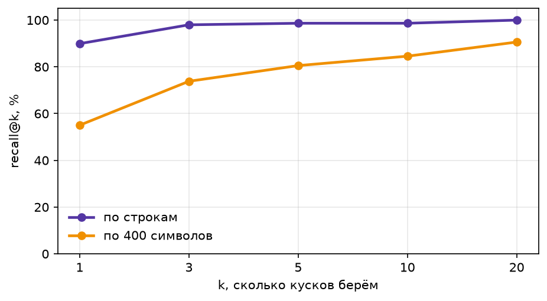
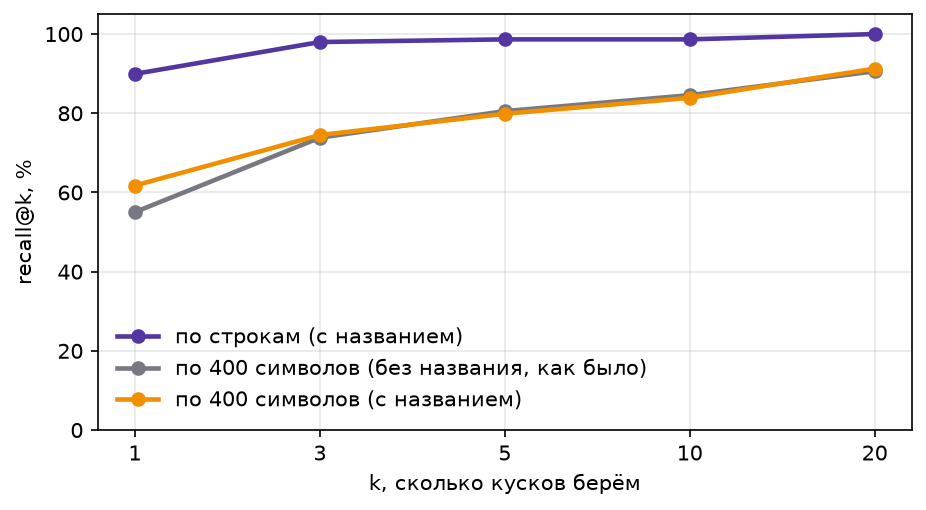
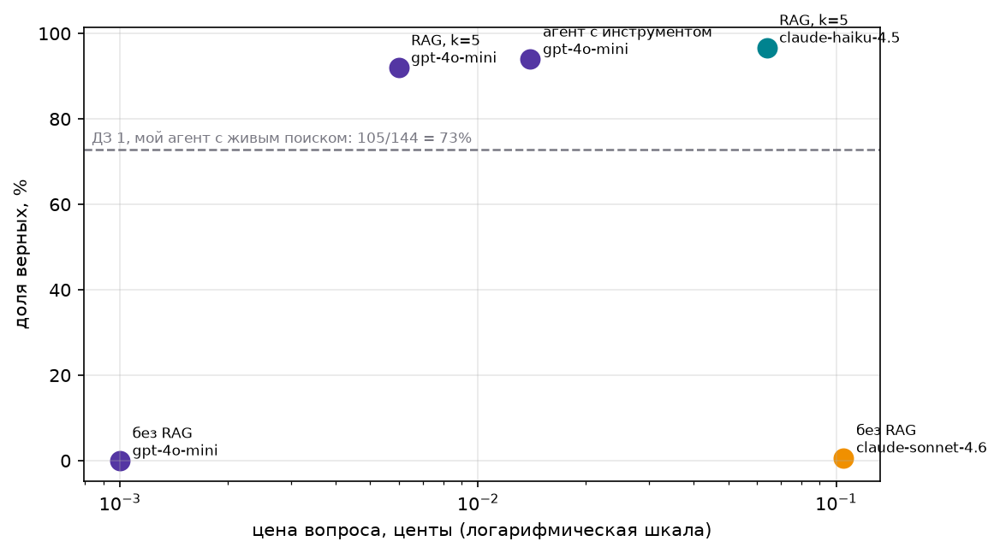
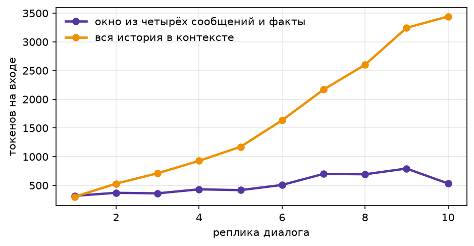
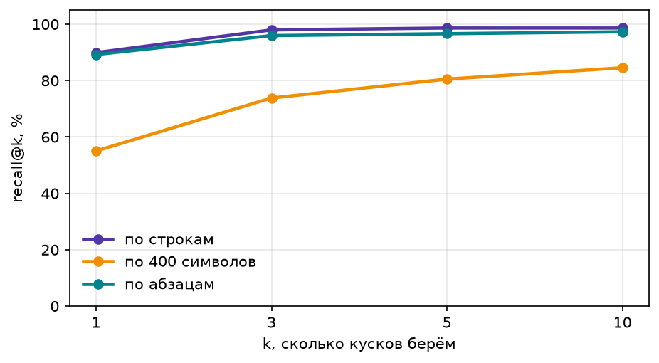

# Домашнее задание 2: база знаний и память агента

Код и данные в `hw2/`: ноутбук `seminar02_skeleton.ipynb` (выполнен целиком), инструменты агента `tools/` (`kb.py`, `memory.py`), тесты `tests/`, картинки `img/`, сырые результаты прогона `results_raw.csv`.

## Как запустить

Нужны Python 3.12+ и Docker.

```
cp ../.env.example .env              # положить OPENROUTER_API_KEY
pip install -r requirements.txt
docker compose up -d milvus          # Milvus v3.0.2 на localhost:19530, лимит памяти 1 ГБ
pytest                               # 11 тестов, без ключа и сети
```

Дальше открыть ноутбук и выполнить ячейки сверху вниз. Эмбеддинги нарезок и вопросов берутся из кэша (`data/embeddings_512.npz` и `emb_cache.npz`): повторный запуск делает 0 запросов к API (проверено). Заново считаются только тексты, которые каждый раз придумывает сама система (запросы агента и факты памяти): 172 вызова, 0,00004 USD. Весь ноутбук стоит около 0,29 USD (в основном ответы сильной модели).

## Набор данных

- **Корпус**: 28 страниц английской Википедии «2026 in ...», 882 тыс. символов. Скачивает `fetch_corpus.py`, готовый файл лежит в `data/corpus_2026.jsonl`.
- **Вопросы**: `data/fresh_2026.jsonl`, 149 вопросов первой домашки (у двух цитата-эталон пропала из корпуса). В записи есть вопрос, короткий ответ, цитата (`evidence`), страница и ссылка. Замер идёт на всех 149.
- **Вопросы без ответа**: `data/unanswerable_2026_v2.jsonl`, 10 штук о событиях того же периода, что и корпус (см. «Отказы»). Я проверил поиском по тексту, что в корпусе ответа нет. Первый набор из заготовки семинара (`data/unanswerable_2026.jsonl`) был почти весь о событиях позже корпуса и оставлен только для истории.
- **Правка по фидбэку к первой домашке**: пять своих вопросов подсказывали ответ («Which former French prime minister...» это Жоспен). Я переписал их так, чтобы спрашивалась деталь события. С первого раза три из них снова оказались угадываемыми: «сколько лет было Жоспену» считается по году рождения и дате смерти из вопроса, и Sonnet без инструментов ответил 88 и 96. Теперь про этих троих спрашивается дата смерти, а остальные два про дату отмены рейсов Air France в Гавану и про статус ЮНЕСКО. После правки Sonnet без инструментов отвечает верно на 1 вопрос из 149. Правка есть и в hw1 (два отдельных коммита), но результаты hw1 не перезапускались.
- **Проверка ответа** (`is_correct`) исправлена по тому же фидбэку: понимает числа с единицами (`41.5 °C`), числа словами и тысячи (`thirty thousand` и `30000`), «at least six» и `6`, перестановку слов (`Minister of Education`). Ответ без строки `FINAL:` больше не засчитывается по всему тексту. Те же правки в hw1.

## Нарезка и поиск

Режем двумя способами:

| Нарезка | Кусков | Средняя длина |
|---|---|---|
| по строкам | 5 986 | 138 символов |
| по 400 символов | 2 213 | 400 символов |

Осмысленная нарезка по строкам: одна строка Википедии это одно событие с датой, поэтому граница между кусками проходит между событиями, а заголовок раздела (месяц) идёт в метаданные. Наивная нарезка рвёт событие пополам. У каждого куска в метаданных страница, раздел и ссылка.

Эмбеддинги: `text-embedding-3-small`, размерность 512, кэш на диске по хэшу текста. Коллекция `lines` в Milvus с метаданными. Фильтр в демонстрации: `page == "2026 in Japan"` для запроса «earthquake magnitude» возвращает только строки про Японию. Выдача Milvus совпадает с перебором на numpy на 97,3%, у 133 вопросов из 149 пятёрка полностью совпала (индекс приближённый).

Качество поиска, доля вопросов, у которых верный кусок есть среди первых k:

| k | по строкам | по 400 символов |
|---|---|---|
| 1 | 0,90 | 0,56 |
| 3 | 0,98 | 0,74 |
| 5 | 0,99 | 0,81 |
| 10 | 0,99 | 0,85 |



Дальше берём k=5 на нарезке по строкам: после k=3 кривая почти плоская, а каждый лишний кусок это токены в контексте.

Гибрид: поиск по словам (вес слова IDF) плюс слияние рангов RRF.

| Нарезка | Поиск | recall@1 | recall@5 |
|---|---|---|---|
| по 400 символов | вектор | 0,56 | 0,81 |
| по 400 символов | слова | 0,77 | 0,89 |
| по 400 символов | гибрид | 0,72 | 0,87 |
| по строкам | вектор | 0,90 | 0,99 |
| по строкам | слова | 0,91 | 0,98 |
| по строкам | гибрид | 0,91 | 1,00 |

На строках гибрид не хуже лучшего из двух, но разница в один-два вопроса из 149. На наивной нарезке слова сильнее вектора, потому что в вопросах много дат и имён, и гибрид оказывается посередине. Выигрыш даёт сама нарезка, а не способ поиска.

**Честное сравнение.** Строки эмбеддились вместе с названием страницы («2026 in Japan: ...»), а куски по 400 символов без него, так что часть разрыва давал заголовок. Пересчёт, где у обеих нарезок одинаковый текст для эмбеддинга (ноутбук, раздел «Правки по фидбеку», Ф4):

| Нарезка | recall@1 | recall@5 | гибрид, recall@1 | гибрид, recall@5 |
|---|---|---|---|---|
| по 400 символов, без названия (как было) | 0,55 | 0,81 | 0,72 | 0,87 |
| по 400 символов, с названием | 0,62 | 0,80 | 0,72 | 0,88 |
| по строкам, с названием | 0,90 | 0,99 | 0,91 | 1,00 |

Заголовок даёт 7 пунктов recall@1 из 35, остальное разница самих нарезок. Вывод не меняется.



## Агент и результаты

Все 149 вопросов, поиск по строкам с k=5. Модели: дешёвая `gpt-4o-mini`, средняя `claude-haiku-4.5`, сильная `claude-sonnet-4.6`. Инструмент агента `knowledge_base(query, page)` лежит в `tools/kb.py`, у него 7 тестов без модели (обычный запрос, фильтр по странице, пусто, ошибка и другие).

В таблице две колонки: «авто» это доля по автоматической проверке, «вручную» после моего просмотра всех ошибок и всех нестрогих совпадений (список ниже).

| Конфигурация | Модель | Верных, авто | Верных, вручную | Цена задачи, USD | Цена верного, USD |
|---|---|---|---|---|---|
| Сильная, без инструментов | sonnet-4.6 | 1/149 | 2/149 | 0,00105 | 0,15658 |
| Дешёвая, живой поиск из hw1 * | gpt-4o-mini | 105/144 | 105/144 | 0,00036 | 0,00049 |
| Дешёвая, RAG всегда | gpt-4o-mini | 137/149 (92%) | 138/149 (93%) | 0,00006 | 0,00007 |
| Дешёвая, агент с `knowledge_base` | gpt-4o-mini | 140/149 (94%) | 145/149 (97%) | 0,00014 | 0,00015 |
| Средняя, RAG всегда | haiku-4.5 | 144/149 (97%) | 144/149 (97%) | 0,00064 | 0,00066 |
| (справочно) дешёвая, без инструментов | gpt-4o-mini | 0/149 | 0/149 | 0,00001 | нет верных |

\* Строка не перезапускалась: взяты ответы hw1 (`hw1/results_raw_full.csv`, конфигурация «поиск и чтение страницы», вопросы сопоставлены по тексту) и пересчитаны исправленной проверкой. Старой проверкой было бы 101 из 144, четыре добавленных ответа это промахи из фидбэка к hw1. Пять переписанных вопросов исключены: у hw1 нет ответов на новые формулировки, поэтому строка посчитана на 144 вопросах, а не на 149.

Что поменено вручную (идентификаторы из `results_raw.csv`):
- проверка не засчитала, хотя ответ верный: `fresh-105` и `fresh-143` («Leipzig Airport drone attack» без «2026» в начале), `fresh-40` («Narendra Modi» без «Prime Minister»), `fresh-84` («£30.4 billion» против «£30.4bn»), `fresh-107` у агента («Arson conspiracy» против «conspiracy to commit arson»), `fresh-106` у haiku (опечатка «Michaelms» вместо «Michaelmas», но остров назван ясно);
- проверка не засчитала, хотя ответ верный, у sonnet без инструментов: `fresh-56` («BYD» против «BYD Auto»), этот случай я сначала пропустил;
- проверка засчитала, хотя ответ с двумя числами: `fresh-28` у haiku («46 человек, хотя один источник пишет 43», эталон 43).



Пунктир на картинке это мой агент ДЗ 1 с живым поиском: 105 из 144, 73% (строка таблицы со звёздочкой). Раньше там стояло семинарское поле `agent_ok` (66%), картинка расходилась с таблицей.

Сырые ответы всех прогонов: `results_raw.csv`.

## Отказы

10 вопросов без ответа (`data/unanswerable_2026_v2.jsonl`), все о том же периоде, что и корпус:

- пять о реальных событиях 2026 года, у которых в корпусе есть только анонс, без итога: победители Уимблдона, Roland Garros и Australian Open, места социал-демократов на выборах в Дании, чемпион Бундеслиги;
- пять о правдоподобных, но не случившихся событиях: землетрясение в Лиссабоне, паром у берегов Греции, банкротство немецкой авиакомпании, эвакуация из Рейкьявика, тайфун в Японии в феврале.

Отказ теперь определяется по строке `FINAL:`, а не по всему тексту ответа. Раньше `NOT_FOUND`, упомянутый по ходу рассуждения, делал верный ответ «отказом» (у дешёвой RAG так были помечены верные `fresh-63`, `fresh-128`, `fresh-129`, `fresh-145`). Ответы всех конфигураций на вопросы без ответа сохранены в `results_unanswerable.csv`.

| Конфигурация | Честно отказала из 10 вопросов без ответа | Зря отказала из 149 вопросов с ответом |
|---|---|---|
| Дешёвая, RAG | 10 | 8 |
| Средняя, RAG | 10 | 2 |
| Дешёвая, агент с `knowledge_base` | 10 | 1 |

Выдуманных ответов нет и на новом, более трудном наборе: на вопросы, где в корпусе есть анонс события, все конфигурации отвечают `NOT_FOUND`, а не догадкой. Счёт «зря отказала» не изменился: он и раньше считался только по неверным ответам, а неверная пометка касалась верных. Цена честности у дешёвой модели: восемь раз `NOT_FOUND` на вопрос, ответ на который есть (разбор ниже). Близость лучшего куска у вопросов без ответа ниже (медиана 0,60 против 0,76 на первом наборе), но диапазоны пересекаются, поэтому одним порогом близости отказ не сделать. Таблица посчитана в ноутбуке, раздел «Правки по фидбеку», Ф2 и Ф3.

## Разбор провалов

В поиске ошибаются редко: верный кусок есть в топ-5 у 147 вопросов из 149. Ошибки лежат дальше. Из 12 ошибок дешёвой RAG одна «поиск не нашёл», 11 «нашёл, но ответ неверный или отказ». У haiku из 5 ошибок одна «не нашёл» и четыре «нашёл».

**Поиск не нашёл.** «Who entered negotiations with the Trump administration on March 13, 2026?», эталон Miguel Díaz-Canel (страница «2026 in politics»). В топ-5 попали пять строк про переговоры Трампа с Ираном (близость 0,58–0,62): в вопросе нет слова «Cuba», и вектор цепляется за «Trump» и «negotiations». Все модели честно ответили `NOT_FOUND`. Менять нужно поиск: слова «March 13» и «administration» стоят в нужной строке рядом, и гибрид на строках давал recall@5 = 1,00. Ещё помог бы фильтр по странице через `knowledge_base(page=...)`.

**Нашёл, но модель отказалась.** «In which German city did a meteorite strike the roof of a house on 8 March 2026?», эталон Koblenz. Нужная строка («A meteorite strikes a roof of a house in Koblenz, Rhineland-Palatinate») стоит на первом месте с близостью 0,79, но `gpt-4o-mini` ответил `NOT_FOUND`: в строке нет даты 8 марта, и дешёвая модель сочла источник неподходящим. То же случилось ещё в шести вопросах (например, про 30,2% Зелёных в Баден-Вюртемберге). Менять надо промпт: разрешить отвечать, если событие описано, даже когда дата из вопроса в источнике не повторена. Или взять модель посильнее: haiku на эти вопросы отвечает. Нарезку по абзацам, которая возвращает дату, я проверил в шаге 5: она исправила четыре из восьми таких отказов, но сломала другие.

**Нашёл, но источники расходятся.** «How many people were killed in the train derailment near Adamuz, Spain, in January 2026?», эталон 43. Страницы «2026» и «2026 in rail transport» пишут 46, страница «2026 in Spain» пишет 43. Дешёвая модель и агент взяли 46, haiku дал 46 с оговоркой про 43. Здесь тоже промпт: просить назвать расхождение и выбрать самый свежий или самый частый источник. Тот же эффект на вопросе про рекордное расстояние Artemis II (252 756 миль на одной странице, 252 757 на другой).

## Память

Две памяти, код в `tools/memory.py`.

- **Эпизодическая**: журнал реплик `episodes.jsonl` (сессия, время, роль, текст). В контекст не идёт, в репозиторий не коммитится.
- **Семантическая**: факты о пользователе, которые дешёвая модель извлекает в конце сессии, лежат в отдельной коллекции Milvus `facts`, к вопросу достаются три ближайших. Модель получает старые факты и возвращает обновлённый список целиком, поэтому новый факт, отменяющий старый, заменяет его.

**Две сессии (пользователь Олег, SDET из Москвы).** Первая: «Меня зовут Олег, я SDET из Москвы: пишу автотесты и ломаю чужие сервисы. Обожаю Формулу 1, слежу за ИИ и сбоями сервисов, отвечай коротко и по делу» и вопрос про Australian Grand Prix 2026 (ответ найден: Джордж Рассел). В памяти пять фактов: имя, город Москва, работа SDET, интересы «Формула 1, ИИ, сбои сервисов», пожелание «коротко и по делу». Во второй сессии история первой в контекст не попадает, но на вопрос «Что интересного случилось в моих темах за год?» агент перечисляет Формулу 1, ИИ и сбои сервисов, то есть использует факты. Потом Олег пишет: «Формула 1 мне надоела, теперь слежу за футболом. И я переехал в Берлин». После сессии в памяти `Город: Берлин` и `Интересы: Футбол, ИИ, сбои сервисов`, остальное без изменений.

Слабое место: хранение и замена фактов работают, но дешёвая модель плохо ими пользуется. Ответы во второй сессии длинные и с нумерованными списками, хотя пожелание «коротко и по делу» записано, а про сбои сервисов она ответила догадками вместо найденной в источниках строки про Telstra. Дело в поиске по общему запросу «мои темы» и в самой модели, не в памяти.

**Токены.** Диалог из 10 реплик, два режима:

| Режим | Токенов на входе | Цена диалога, USD |
|---|---|---|
| вся история в контексте | 16 731 | 0,00244 |
| окно из четырёх сообщений и факты | 5 123 | 0,00117 |



Токенов на входе втрое меньше, цена вдвое: ответы модели стоят одинаково, экономия идёт только на входе. Вся история растёт с каждой репликой, окно с фактами остаётся на одном уровне.

**Тесты без модели** (`tests/test_memory.py`, 4 теста на заглушке вместо Milvus и эмбеддера): пустая память, найденный факт, заменённый факт (старого нет ни в файле, ни в коллекции), журнал не попадает в факты.

## Шаг 5 (дополнительно): нарезка по абзацам

Идея: в Википедии дата часто стоит отдельной короткой строкой («8 March»), а события под ней идут строками без даты. Нарезка по строкам такие короткие строки отбрасывает, и у 55% строк (дату в начале имеют 2 694 из 5 996 строк длиннее 40 символов) даты в куске нет, она осталась строкой выше. Поэтому дешёвая модель отвечала `NOT_FOUND` на «в каком городе упал метеорит 8 марта»: в куске про Koblenz даты нет. Абзац здесь это дата вместе со всеми её событиями (`chunk_paragraphs` в ноутбуке, раздел «Шаг 5»); событие, которое само начинается с даты, остаётся отдельным куском. Получилось 4 738 кусков, в среднем 176 символов, коллекция `paragraphs` в Milvus.

Recall@k (рядом нарезка по строкам и по 400 символов):

| k | по строкам | по абзацам | по 400 символов |
|---|---|---|---|
| 1 | 0,90 | 0,89 | 0,55 |
| 3 | 0,98 | 0,96 | 0,74 |
| 5 | 0,99 | 0,97 | 0,81 |
| 10 | 0,99 | 0,97 | 0,85 |



RAG на тех же 149 вопросах (k=5, автоматическая проверка, без ручной правки; сырые ответы в `results_paragraphs.csv`):

| Нарезка | Модель | Верных | Цена задачи, USD | Цена верного, USD | Зря отказов |
|---|---|---|---|---|---|
| по строкам | gpt-4o-mini | 137/149 (92%) | 0,00006 | 0,00007 | 8 |
| по абзацам | gpt-4o-mini | 135/149 (91%) | 0,00007 | 0,00008 | 11 |
| по строкам | haiku-4.5 | 144/149 (97%) | 0,00064 | 0,00066 | 2 |
| по абзацам | haiku-4.5 | 141/149 (95%) | 0,00071 | 0,00075 | 6 |

На вопросы без ответа дешёвая модель с абзацами снова честно отказала 10 из 10.

**Что изменилось по вопросам.** Из восьми вопросов, на которые дешёвая модель зря отвечала `NOT_FOUND` на строках, абзацы исправили четыре, и это именно «потерянная дата»: Koblenz (8 March), 30,2% Зелёных, Tomahawk, приговор в 13 лет. Остальные четыре не исправились: `fresh-2` (поиск не нашёл), и ещё три модель снова отклонила. Зато сломалось восемь других вопросов (исправилось шесть): у трёх из них верный кусок вообще пропал из топ-5, у остальных модель отказалась (один «сломался» только из-за формата ответа `£30.4 billion` против `£30.4bn`).

**Вывод.** Абзац возвращает дату и чинит часть отказов, но целиком не помогает: в один кусок попадают несвязанные события дня, эмбеддинг размывается, и recall@5 падает с 0,99 до 0,97 (верный кусок реже попадает в топ). В итоге на 149 вопросах абзацы чуть хуже строк у обеих моделей, а контекст на 10% дороже у haiku. Разница в 2–3 вопроса это уровень шума: один и тот же прогон дешёвой модели по абзацам дал 134 и 135 верных. 

## Расход

Шаги 1–3 вместе (149 вопросов в пяти конфигурациях, десять вопросов без ответа, эмбеддинги): 0,285 USD при бюджете 30–50 центов. Больше половины съела сильная модель без инструментов (0,157 USD), ещё 0,095 USD средняя модель. Память: 0,004 USD. Шаг 5 (нарезка по абзацам, RAG двух моделей на 149 вопросах): 0,117 USD за прогон, прогонов было два. Правки по фидбеку (новые вопросы без ответа в трёх конфигурациях, эмбеддинги кусков с названием страницы): 0,018 USD.

## Вывод

 Верный ответ стал дешевле, чем на прошлой неделе: RAG на дешёвой модели стоит 0,00007 USD за верный ответ при 93% верных, а агент с живым поиском из hw1 стоил 0,00049 USD при 73%. Это в 7 раз дешевле и точнее. Сильная модель в одиночку отвечает верно на 1 вопрос из 149 за 0,157 USD, это более чем в 2000 раз дороже. Причина простая: вместо нескольких шагов поиска и длинных страниц модель получает пять нужных строк за один запрос. Поиск находит нужный кусок почти всегда (147 из 149), а ошибки приходятся на дешёвую модель: она отказывается, если в источнике нет даты из вопроса, и путается, когда страницы Википедии расходятся. Средняя модель (haiku) ошибается вдвое реже, но в десять раз дороже. Агент с `knowledge_base` по доле верных на уровне haiku (97% после ручного просмотра), но вдвое дороже «RAG всегда», потому что ходит в базу несколько раз. Память даёт ещё экономию: окно плюс факты вдвое дешевле всей истории и не растёт с длиной диалога.

## Что исправлено по фидбеку

| Пункт фидбека | Что сделано | Коммит |
|---|---|---|
| Пунктир 66% на `money_all.png` это семинарское `agent_ok`, картинка расходится с таблицей | Пунктир теперь мой агент ДЗ 1: 105 из 144 (73%), посчитано в ноутбуке из `hw1/results_raw_full.csv` той же проверкой, что и таблица | [3ed720c](https://github.com/OGrabar/ai_agents/commit/3ed720c) |
| Вопросы без ответа о событиях позже корпуса, все конфигурации 10 из 10, ответы не сохранены | Новый набор `data/unanswerable_2026_v2.jsonl` о том же периоде, что и корпус (пять событий с анонсом без итога, пять правдоподобных выдуманных); ответы в `results_unanswerable.csv`. Результат тот же: 10 из 10 у всех конфигураций | [3ed720c](https://github.com/OGrabar/ai_agents/commit/3ed720c) |
| `refused` ищет `NOT_FOUND` во всём тексте, верные fresh-63, 128, 129, 145 помечены отказами | Отказ определяется по строке `FINAL:`; у дешёвой RAG отказов 8 вместо 12, все четыре верных ответа больше не отказы | [3ed720c](https://github.com/OGrabar/ai_agents/commit/3ed720c) |
| Сравнение нарезок не чистое: строки с названием страницы, куски по 400 символов без | Пересчёт с названием у обеих: recall@1 кусков по 400 символов 0,62 вместо 0,55, у строк 0,90; заголовок давал 7 пунктов из 35 | [3ed720c](https://github.com/OGrabar/ai_agents/commit/3ed720c) |
| Ручной просмотр пропустил fresh-56 (BYD против BYD Auto) | Засчитан вручную, sonnet без инструментов 2 из 149 | [3ed720c](https://github.com/OGrabar/ai_agents/commit/3ed720c) |
| Служебные строки в сообщениях коммитов b9c070b и 1397f2b | Сообщения коммитов очищены, содержимое коммитов не менялось; новые хэши этих коммитов [852db6f](https://github.com/OGrabar/ai_agents/commit/852db6f) и [5ab7c2b](https://github.com/OGrabar/ai_agents/commit/5ab7c2b) | история переписана |

Шаги 1–5 не перезапускались: правки сделаны отдельным разделом ноутбука «Правки по фидбеку» поверх сохранённых результатов.
