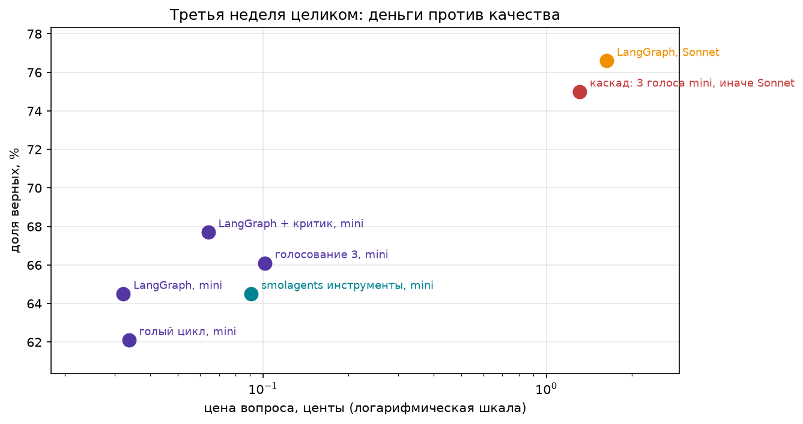
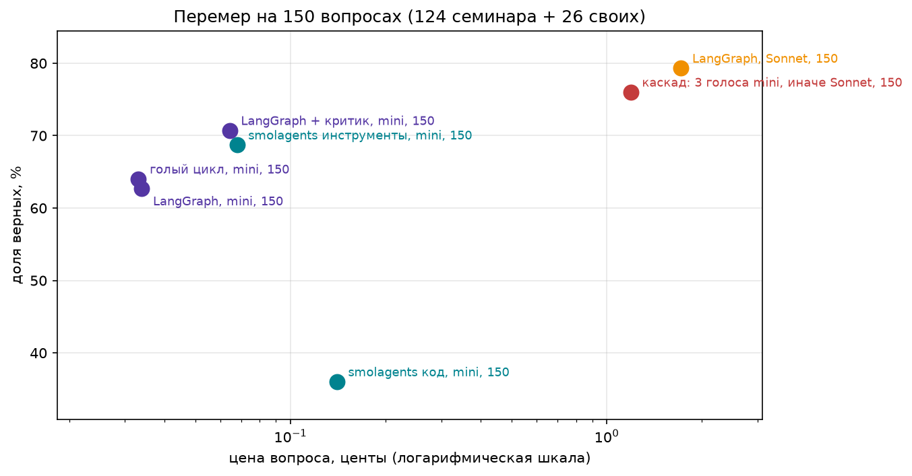

# Домашнее задание 3: фреймворк, критик, голосование, что окупается

Код и данные в `hw3/`: ноутбук `hw3.ipynb` (выполнен целиком, порядок ячеек повторяет шаги задания), данные `data/`, сохранённые результаты каждой конфигурации `results/`, итоговая таблица `results_table.csv`, картинки `img/`.

## Как запустить

Нужен Python 3.12+. Docker не нужен.

```
cp .env.example .env                 # положить OPENROUTER_API_KEY
pip install -r requirements.txt
# открыть hw3.ipynb в Jupyter или VS Code и выполнить ячейки сверху вниз
```

Итог каждой конфигурации (ответы, вызовы, цены) пишется в `results/<метка>.json`. Повторный запуск берёт их оттуда и ничего не тратит; чтобы пересчитать конфигурацию, удалить её файл. Википедия читается из снимка `data/wiki_snapshot.json.gz`, чего в нём нет, идёт в живую. Весь ноутбук на 124 вопросах с нуля стоит около 4,3 USD (почти всё Sonnet и каскад, см. «Стоимость»).

## Что сделано

- **Агент**: тот же, что на семинаре. Вопросы о событиях 2026 года, два инструмента (`web_search` и `page_find` по Википедии), короткий ответ. Дешёвая модель `gpt-4o-mini`, сильная `claude-sonnet-4.6`.
- **Вопросы**: `data/fresh_2026.jsonl`, 124 штуки, **все конфигурации посчитаны на всех 124**. Эталон fresh-28 исправлен с 43 на 46 (Википедия обновила число погибших, см. «Проверку проверки»).
- **Счётчик**: один `httpx.Client` с крючком на ответ, через который ходят все исполнения (голый цикл, LangGraph, smolagents). Из ответа берутся токены и цена `usage.cost`, на каждом вызове стоит метка конфигурации.
- **Изменения относительно семинарского кода**: сохранение результатов в `results/`, таймауты на запросы, голосующим агентам добавлена просьба отвечать не более чем пятью словами, нормализация в `is_correct` расширена (см. ниже).

## Итоговая таблица

| Конфигурация | Верно | Вызовов на вопрос | Токенов на вопрос | Центов на вопрос | Центов за верный |
|---|---|---|---|---|---|
| голый цикл, mini | 77 (0,62) | 3,7 | 1987 | 0,034 | 0,054 |
| LangGraph (с починками), mini | 80 (0,65) | 3,7 | 1902 | 0,032 | 0,050 |
| LangGraph как есть, mini | 61 (0,49) | 4,4 | 2647 | 0,042 | 0,086 |
| smolagents, инструменты, mini | 77 (0,62) | 3,8 | 6149 | 0,069 | 0,111 |
| smolagents, код, mini | 39 (0,31) | 4,6 | 13301 | 0,142 | 0,450 |
| LangGraph + критик, mini | 84 (0,68) | 6,6 | 3869 | 0,064 | 0,095 |
| голосование 3, mini | 82 (0,66) | 11,2 | 6161 | 0,102 | 0,154 |
| каскад: 3 голоса mini, иначе Sonnet | 93 (0,75) | 13,9 | 9613 | 1,312 | 1,750 |
| LangGraph, Sonnet (ориентир) | 95 (0,77) | 3,6 | 4455 | 1,635 | 2,134 |



**Шум.** Одна и та же конфигурация при повторном прогоне даёт разные цифры: в двух полных прогонах (одна и та же проверка) LangGraph набрал 68 и 80 из 124, голый цикл 73 и 77, критик 88 и 84. Модель при температуре 0 через OpenRouter не детерминирована. Строки smolagents пересчитаны в равных с циклом условиях (`max_steps=6` вместо 10, то же описание `web_search`), см. «Что исправлено по фидбеку». Разницу в 5-10 вопросов из 124 нельзя считать эффектом, и это касается всех дешёвых строк таблицы.

## Фреймворк и его налог

LangGraph (`create_agent`) с теми же инструментами, промптом и моделью.

- **Как есть**: 61/124. Две потери. Первая: из-за схемы инструментов по подсказкам типов пропали описания аргументов (у `page_find` осталось `{"type": "string"}` вместо «exact article title, e.g. 2026 in Japan»). Вторая: 33 вопроса из 124 закончились `GraphRecursionError`, граф падал на последнем шаге и выбрасывал найденное.
- **С починками** (описания аргументов через Pydantic, слой, который на последнем шаге убирает инструменты): 80/124 при цене как у голого цикла.

**Пустой запрос** (`2 + 2`, без поиска), токенов в первом вызове:

| Исполнение | Токенов на входе | Инструментов |
|---|---|---|
| голый цикл | 176 | 2 |
| LangGraph с починками | 176 | 2 |
| smolagents, инструменты | 1139 | 3 |
| smolagents, код | 2139 | 0 |

Запрос голого цикла и LangGraph совпадают с точностью до порядка ключей и лишнего поля `stream: false`. Налог исправленного LangGraph на пустом запросе нулевой. У smolagents разница идёт из встроенного системного промпта (у CodeAgent около 9 000 символов) и лишнего инструмента `final_answer`.

**Одна фраза.** Фреймворк за свои токены ничего не добавил к качеству (в пределах шума), его польза в явном графе (критик, потолок), а не в самом цикле; smolagents дороже в 2-4 раза и без прироста, а CodeAgent хуже всех.

## Два паттерна

**Критик с опорой.** Граф `answer → critic → answer`: критик проверяет ответ по тексту, который агент нашёл (`evidence`), вердикт по схеме, не больше двух попыток. 84 верных против 80 без критика: «исправил» 8, «испортил» 4, то есть чистый плюс 4 ответа (3 п. п.) за удвоенную цену вопроса (0,064 против 0,032 цента), цена верного ответа 0,095 против 0,050. Это в пределах шума: «исправил 8 и испортил 4» включает случайную разницу двух независимых прогонов (при каждом исполнении агент заново ищет и по-разному отвечает), контроля «просто повторить без критика» нет. Вывод: прирост критика на этих данных не доказан.

**Голосование и каскад.** Три независимых прогона агента при температуре 0,7, ответ большинством. Голосующим просят отвечать не более чем пятью словами, согласие считается как совпадение ответов, сравниваемых как набор слов. Если согласны не все три, вопрос уходит Sonnet.

- Голосование само по себе: 82/124 (80 у одного прогона), цена верного 0,154, то есть втрое дороже без заметного прироста.
- **Каскад: наверх ушло 78 вопросов из 124 (63%)**, это много: даже короткие ответы расходятся по записи («Ekrem İmamoğlu, July 2026» против «İmamoğlu»). Каскад верен на 93/124 против 95 у Sonnet в одиночку и стоит 1,75 цента за верный против 2,13, то есть на 18% дешевле. Из 78 ушедших наверх он ответил верно на 55, из 46 оставленных на mini верно 38 (Sonnet на тех же 46: 40). Экономия есть, но небольшая, и 2 верных ответа потеряны.

## Проверка проверки

Для критика и каскада прочитал по 10 ответов, которые `is_correct` счёл неверными, в несколько заходов (после правок выборка менялась; все они описаны в ноутбуке):

1. Из 20 верными оказались 2: `eleventh` против `11th` и устаревший эталон (Википедия обновила число погибших в Адамусе с 43 до 46).
2. Критик, ещё 10: 2 верных. «28» против «28 people» и `14` против `Fourteen`.
3. Итоговый прогон: критик 1 из 10 (`life sentence` против `life imprisonment`), каскад 1 из 10 (`8` против `eight games`). Остальные настоящие: отказы вида «не нашёл» (поиск агента промахнулся) и неверные имена.

Поправил: порядковые числительные и числа словами до двадцати, слово `people` не учитывается, эталон fresh-28 стал 46. Результаты пересчитываются из сохранённых ответов, без новых вызовов. Не поправил: синонимы, эталоны с существительным после числа (`eight games`), сокращения единиц (`bn`) и два вопроса с расхождением чисел (fresh-35: 136 против 129, fresh-27: «Six» против «nine»), возможно, Википедия обновила и их, но по текущей странице я это не проверял. Дальше подгонять проверку под эти же данные не стал. Оставшиеся промахи занижают долю верных на 1-3 ответа из 10 просмотренных неверных на конфигурацию, на общий вывод это не влияет.

## Потолок на деньги

`ModelCallLimitMiddleware(run_limit=2, exit_behavior="end")` ограничивает число вызовов модели кодом, а не промптом. На первом вопросе набора («On what date did Ukraine boycott the closing ceremony of the 2026 Winter Paralympics?», эталон «15 March») агент делает поиск, и после второго вызова граф обрывается до ответа. Агент отдаёт не ответ, а служебное сообщение `Model call limits exceeded: run limit (2/2)`: найденное теряется.

Полезнее второй вариант: тот же жёсткий потолок остаётся страховкой, но на последнем разрешённом вызове слой `answer_on_last_call` убирает инструменты и просит ответить тем, что уже найдено (тот же приём, что `last_step_without_tools`). На этом вопросе агент отвечает «March 15, 2026». Сравнение при одинаковом потолке в 2 вызова на первых 10 вопросах:

| Вариант | Верно из 10 | Служебная строка вместо ответа | Вызовов модели |
|---|---|---|---|
| обрыв (как на семинаре) | 3 | 7 | 20 |
| ответ из найденного | 3 | 0 | 20 |

Денег оба варианта тратят одинаково. Точность при таком жёстком потолке не растёт (за один поиск модель часто не находит деталь и честно говорит, что её нет), но вместо служебной строки пользователь получает осмысленный ответ. Показано в разделе «Шаг 5» ноутбука.

## Перемер на 150 вопросах, из них 26 своих

По фидбеку перемерены голый цикл, LangGraph, оба smolagents, критик, каскад и Sonnet на наборе `data/feedback_set.jsonl`: 124 вопроса семинара и 26 моих вопросов из второй домашки (`own-123…own-148` это `fresh-123…fresh-148` из `hw2/data/fresh_2026.jsonl`). В семинарской части исправлены два эталона: fresh-35 теперь 136 (так пишет статья 2026 Flores earthquake в снимке, все конфигурации ответили 136), у fresh-27 вопрос переписан однозначно («including the perpetrator», ответ nine). Ответы в `results/` с меткой «, 150», таблица в `results_table_150.csv`, раздел «Перемер по фидбеку» в ноутбуке.

| Конфигурация | Верно из 150 | Свои 26 | Семинарские 124 | Вызовов на вопрос | Токенов на вопрос | Центов на вопрос | Центов за верный |
|---|---|---|---|---|---|---|---|
| голый цикл, mini | 96 (0,64) | 20 | 76 | 3,7 | 1960 | 0,033 | 0,052 |
| LangGraph, mini | 94 (0,63) | 20 | 74 | 3,8 | 2042 | 0,034 | 0,054 |
| smolagents, инструменты, mini | 103 (0,69) | 21 | 82 | 3,7 | 6043 | 0,068 | 0,099 |
| smolagents, код, mini | 54 (0,36) | 13 | 41 | 4,6 | 13262 | 0,140 | 0,390 |
| LangGraph + критик, mini | 106 (0,71) | 21 | 85 | 6,7 | 3875 | 0,064 | 0,091 |
| каскад: 3 голоса mini, иначе Sonnet | 114 (0,76) | 21 | 93 | 13,7 | 9303 | 1,191 | 1,567 |
| LangGraph, Sonnet | 119 (0,79) | 22 | 97 | 3,8 | 4676 | 1,717 | 2,164 |



- **Мои вопросы проще семинарских** для всех, кроме CodeAgent: 20-22 из 26 (77-85%) против 60-78% на семинарских. Они про две страницы («2026 in France», «2026 in Germany»), и `page_find` по обзорной странице находит строку почти сразу. Разница между конфигурациями на них 1-2 вопроса, то есть на своих вопросах паттерны ничего не меняют.
- **Критик** на 150 вопросах: «исправил» 14, «испортил» 2, 106 против 94 у LangGraph без критика. Это больше, чем на прошлом прогоне (8 против 4), но оговорка та же: это два независимых прогона без контроля. LangGraph без критика сам набирал от 68 до 80 из 124 в разных прогонах.
- **Каскад**: наверх ушло 88 вопросов из 150 (59%), из них 13 своих. Каскад верен на 114 против 119 у Sonnet в одиночку и стоит 1,57 цента за верный против 2,16, на 28% дешевле, но теряет 5 верных ответов. Из 62 оставленных на mini верно 51 (у Sonnet на тех же 55).
- Выводы ниже не меняются: на дешёвой модели ни критик, ни голосование не вышли уверенно за шум, а каскад дешевле Sonnet ценой нескольких верных ответов.

**Вывод перемера**: на 150 вопросах порядок конфигураций тот же, что на 124: голый цикл и LangGraph на одном уровне, критик даёт +12 верных, а верный ответ у него дороже в 1,7 раза, каскад дешевле Sonnet на 28% ценой 5 верных, Sonnet точнее всех, но верный ответ у него в 40 раз дороже, чем у голого цикла. Свои вопросы проще семинарских и конфигурации на них почти не различаются.

## Два вывода

1. **Дало прирост**: на этих данных ничего из паттернов не превзошло шум на дешёвой модели (критик +4, голосование +2 верных из 124). Реально сдвигает качество только сильная модель (+12 пунктов над mini), а каскад даёт её качество на 18% дешевле за верный ответ ценой потери 2 ответов и 63% эскалаций.
2. **Дорогое украшение**: голосование (в три раза дороже без прироста), smolagents (в 2-4 раза дороже), особенно CodeAgent (31% верных, 0,45 цента за верный), и LangGraph сам по себе: после починок равен голому циклу, «как есть» хуже его.

## Стоимость

Полный прогон на 124 вопросах, по счётчику HTTP (`usage.cost`), долларов:

| Конфигурация | Вызовов модели | Стоимость, USD |
|---|---|---|
| голый цикл, mini | 464 | 0,04 |
| LangGraph с починками, mini | 454 | 0,04 |
| LangGraph как есть, mini | 541 | 0,05 |
| smolagents, инструменты, mini | 474 | 0,09 |
| smolagents, код, mini | 575 | 0,18 |
| LangGraph + критик, mini | 824 | 0,08 |
| голосование 3, mini | 1390 | 0,13 |
| каскад (3 голоса mini, иначе Sonnet) | 1728 | 1,63 |
| LangGraph, Sonnet | 446 | 2,03 |
| **Итого** | | **4,26** |

Почти всё стоит сильная модель: Sonnet в одиночку и эскалации каскада это 86% всех денег. Все дешёвые конфигурации вместе стоят около 0,6 USD. Каскад дешевле Sonnet в одиночку на 20% по сумме (1,63 против 2,03 USD): 78 из 124 вопросов всё равно уходят наверх, а голоса mini добавляют к ним ещё расход.

Перемер по фидбеку на 150 вопросах: голый цикл 0,05, LangGraph 0,05, smolagents 0,10 и 0,21, критик 0,10, каскад 1,79, Sonnet 2,58, всего 4,87 USD.

## Что не делалось

- Бонусные паттерн «план» и остановка на подтверждение человеком (по договорённости).
- Часть 2 (`ARCH.md`, `project/`): опциональна, пропущена.
- Шум между прогонами сравним с эффектами паттернов, поэтому выводы про критика и голосование осторожные. Для уверенных выводов нужно несколько прогонов каждой конфигурации.

## Что исправлено по фидбеку

### Обязательная переделка

| Пункт фидбека | Что сделано | Коммит |
|---|---|---|
| Перемерить голый цикл, LangGraph, критик, каскад и Sonnet на наборе от 40 вопросов, куда входят мои fresh-123…fresh-148 из `hw2/data/fresh_2026.jsonl`, с ответами в `results` | Все пять конфигураций (и оба smolagents) перемерены на 150 вопросах: 124 семинара и 26 моих (`own-123…own-148` = `fresh-123…fresh-148` из hw2), ответы в `results/` с меткой «, 150», раздел «Перемер на 150 вопросах» | [hw3-feedback](https://github.com/OGrabar/ai_agents/commit/hw3-feedback) |

### Исправленные минусы

| Пункт фидбека | Что сделано | Коммит |
|---|---|---|
| fresh-35 оставлен непроверенным, хотя в снимке 136 | В наборе перемера эталон 136, все конфигурации ответили верно | [hw3-feedback](https://github.com/OGrabar/ai_agents/commit/hw3-feedback) |
| fresh-27 двусмысленный: в школе шестеро, всего девять с нападавшим | Вопрос переписан однозначно («including the perpetrator», ответ nine) | [hw3-feedback](https://github.com/OGrabar/ai_agents/commit/hw3-feedback) |
| smolagents в других условиях: `max_steps=10` против 6, другое описание `web_search` | `max_steps=6`, описание и подсказка аргумента как у цикла; обе строки пересчитаны на 124 и на 150 вопросах | [hw3-feedback](https://github.com/OGrabar/ai_agents/commit/hw3-feedback) |
| Потолок отдаёт служебную строку, полезнее ответ из найденного | Добавлен слой `answer_on_last_call`: на последнем разрешённом вызове инструменты убираются и агент отвечает найденным; при потолке 2 вызова на 10 вопросах служебных строк 0 вместо 7 при той же цене | [hw3-feedback](https://github.com/OGrabar/ai_agents/commit/hw3-feedback) |

Исходная таблица на 124 вопросах не перезапускалась, кроме строк smolagents: остальные конфигурации взяты из сохранённых ответов в `results/`.
